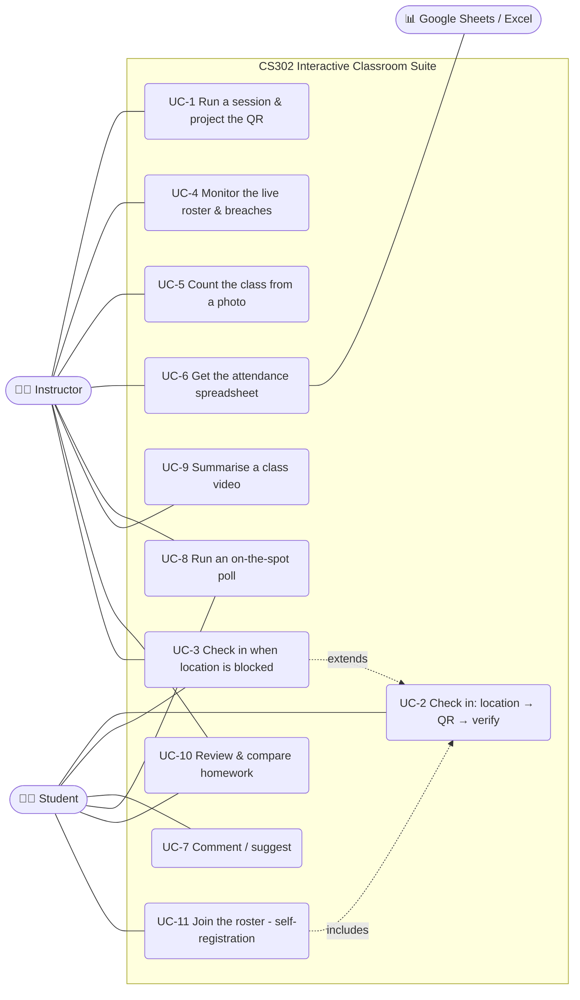

# 4. Use Cases & Client Stories

## 4.1 Use case diagram

## 4.2 Use case descriptions

### UC-1 Run a session & project the QR
| | |
|---|---|
| **Actor** | Instructor |
| **Precondition** | Server started (`python3 server.py --tunnel`), instructor link open on the projector laptop |
| **Main flow** | 1. Instructor opens *📸 Automated Attendance*. 2. Clicks **▶ Start Session** (roster resets). 3. The QR + 6-character code are shown and rotate every 20 s. 4. At the end, clicks **■ End Session**. |
| **Postcondition** | Check-ins accepted only between start and end |
| **Alternatives** | Static QR mode (no rotation); change the classroom location (preset / auto-fetch / manual) |

### UC-2 Check in: location → QR → verify
| | |
|---|---|
| **Actor** | Student |
| **Precondition** | Session active; student is within 500 m of Ariel University |
| **Main flow** | 1. Scans the projected QR with the phone camera (Student Mode opens, code filled in). 2. Picks their name. 3. **Step 1:** taps *📍 Check my location* → allows → sees distance ✓. 4. **Step 2:** (code already there, or scans with *📷 Start Camera*). 5. **Step 3:** *✅ Verify & Check In* → "🎉 Attendance recorded". |
| **Postcondition** | Student present; phone locked to this student for the session; instructor sees the name within 5 s |
| **Exceptions** | E1 expired / wrong code → "Invalid or expired QR", scan again. E2 > 500 m → "Outside the radius", logged as breach. E3 same phone already used → "This phone already checked in X". E4 session ended → "No active session". E5 repeated check-in → "already checked in". |

### UC-3 Check in when location is blocked *(extends UC-2)*
| | |
|---|---|
| **Actors** | Student, Instructor |
| **Trigger** | Step 1 fails (phone settings block location) |
| **Main flow** | 1. Student sees phone-specific steps to allow location (or tests on `/gps`). 2. If not possible: scans the QR, taps **📶 Check my location by Wi-Fi** → accepted if the phone is on the same network as the instructor. 3. Otherwise taps **🙋 Ask the instructor to approve me** → request appears in *🙋 Approvals* → instructor approves after seeing the student. |
| **Postcondition** | Student present with method `qr_network` or `instructor_approved` |

### UC-4 Monitor the live roster & breaches
**Actor:** Instructor. **Flow:** the roster (✓ Present / ⏳ Not checked in / 🚨 Flagged Breaches / 🙋 Approvals) refreshes every 5 s; search by name or ID; manual *Mark Present / Reset*. Breaches list remote attempts (distance) and *SAME PHONE* attempts.

### UC-5 Count the class from a photo
| | |
|---|---|
| **Actor** | Instructor |
| **Main flow** | 1. *📸 Photo count* → take/upload a class photo. 2. Faces are detected in the browser and numbered on the photo. 3. Instructor fixes the number with −/+. 4. *💾 Save* → "N people in the photo vs M check-ins → difference". |
| **Business rule** | The photo never marks anyone present (evaluation only) and is not uploaded |
| **Exception** | No internet → model can't load → message; instructor can still count manually |

### UC-6 Get the attendance spreadsheet
**Actor:** Instructor (+ Google Sheets / Excel). **Flow:** *📥 Export CSV* downloads the file (offline). *🔗 Live Sheet* shows `=IMPORTDATA("…/api/attendance/export.csv")`; pasted into Google Sheets it keeps the sheet in sync (online). Requires the public `--tunnel` link.

### UC-7 Comment / suggest
**Actor:** Student. **Flow:** writes a comment, picks a category, optionally anonymous → appears live; others upvote; instructor marks resolved.

### UC-8 Run an on-the-spot poll
**Actors:** Instructor, Students. **Flow:** instructor types a question + options → students vote once → live percentages → instructor closes the poll.

### UC-9 Summarise a class video
**Actor:** Instructor. **Flow:** uploads a Zoom/Meet/Classroom recording → gets executive summary, chapters with timestamps, key takeaways, action items → asks questions about the lecture. The recording is analysed by Google Gemini (demo mode, clearly labelled, when no API key is set). **Alternative flow:** the model fails or the key is invalid → the lecture is marked *Failed* with the reason, nothing is invented.

### UC-10 Review & compare homework
**Actors:** Instructor, Student. **Flow:** student uploads a .zip or a GitHub link → Gemini reviews it against the assignment requirements (met/missing, SOLID, patterns, problems, each with file:line) → the lecturer sees all submissions, the list of similar-code pairs, and compares two students side by side. **Alternative flows:** not a zip / no source code → clear error; no API key → measured facts only; AI cites a file that does not exist → that finding is removed and counted.

### UC-11 Join the roster (self-registration)
**Actor:** Student not on the list. **Flow:** *Not on the list? Add yourself* → student ID + full name → added and selected. **Rule:** one self-registration per phone per session.

## 4.3 Client stories (user stories)

| ID | As a… | I want to… | So that… | Acceptance criteria |
|---|---|---|---|---|
| CS-1 | student | check in with my phone in a few taps | I don't waste lecture time | ≤ 3 steps, < 30 s, no app install |
| CS-2 | lecturer | be sure students who check in are really in the room | attendance is meaningful | > 500 m rejected; screenshots expire in ~40 s |
| CS-3 | lecturer | stop one student checking in friends | each check-in is one real person | second student from the same phone rejected + logged |
| CS-4 | student whose phone blocks location | still be able to check in | I'm not marked absent unfairly | Wi-Fi check or instructor approval available |
| CS-5 | lecturer | count the class from one photo | I can compare people in the room with check-ins | count shown on the photo, editable, difference displayed |
| CS-6 | lecturer | get attendance as a spreadsheet, offline and online | I can grade and archive it | CSV download + live Google Sheets link |
| CS-7 | lecturer | see the roster update live during class | I know who is missing | refresh ≤ 5 s, search |
| CS-8 | student | send a question or suggestion, anonymously if I want | I can speak up without interrupting | appears live; anonymous hides my name |
| CS-9 | lecturer | launch a quick poll in seconds | I can check understanding on the spot | create < 30 s; one vote per student; live results |
| CS-10 | lecturer | get a summary of my recorded lecture | students can review and I can improve | summary, chapters, takeaways, action items |
| CS-11 | lecturer / student | get a deep review of homework compared with others | feedback is detailed and fair | scores, SOLID, patterns, side-by-side comparison |
| CS-12 | lecturer of a large course | use it with 100+ students at once | it works in a real lecture hall | 150 simultaneous check-ins, 0 failures |
