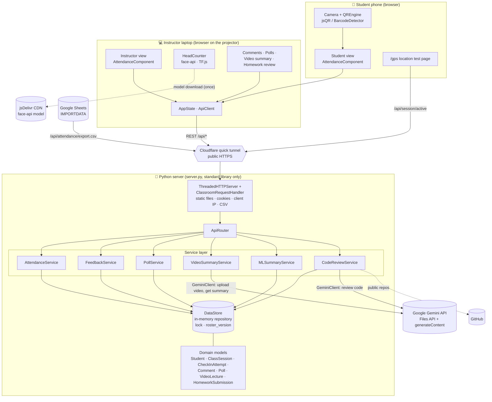

# 5. Main Software Components

## 5.1 Component diagram

## 5.2 Components and responsibilities

| Component | Files | Responsibility |
|---|---|---|
| **HTTP server** | `server.py` | Serves pages and `/api/*`; one thread per request; listen backlog 512; HTTPS (`--https`) or Cloudflare tunnel (`--tunnel`); sets the `cs302_device` cookie; reads the real client IP (`CF-Connecting-IP`); streams the CSV export |
| **Gemini client** | `app/services/gemini_client.py` | Uploads a recording to the Gemini Files API, waits until it is processed, requests a JSON summary / Q&A answer; reads `GEMINI_API_KEY`; falls back to the next model on 404 |
| **API router** | `app/handlers/api_router.py` | Maps method + path to a service call; parses JSON/query; passes per-request client info (device ids, IP) |
| **AttendanceService** | `app/services/attendance_service.py` | All attendance rules: session start/end, QR+GPS verification, one-phone-per-student, Wi-Fi check, approvals, head count, roster summary with versioning, CSV export, self-registration |
| **Other services** | `feedback_service.py`, `poll_service.py`, `video_summary_service.py`, `ml_summary_service.py`, `code_review_service.py` | Comments, polls, video summary (+Q&A), lecture summary, homework review & comparison |
| **Repository** | `app/repositories/datastore.py`, `seed_students.py` | Single in-memory store (Singleton); thread lock; roster version; class roster (104 students from the lecturer's list) |
| **Domain models** | `app/models/*.py` | Encapsulated entities and value objects; HMAC token + Haversine logic in `ClassSession` |
| **Front-end shell** | `static/index.html`, `js/components/app.js`, `js/state.js`, `js/api.js` | Role chooser, tabs, observer state, background sync (instructor 5 s, students 10 s), API facade, device id |
| **Attendance UI** | `js/components/attendance.js` | Instructor view (QR, roster, breaches, approvals, photo count, live sheet) and student view (location → QR → verify) |
| **QR engine** | `js/qr_engine.js`, `js/vendor/qrcode.min.js`, `js/vendor/jsQR.min.js` | QR generation with deep link; camera/photo decoding; token parsing |
| **Head counter** | `js/headcount.js` | In-browser face detection with tiling + duplicate merging; draws numbered boxes |
| **Location test page** | `static/gps.html` | Minimal standalone page to test phone location only |
| **Tests** | `tests/test_app.py`, `tests/load_test.py` | 30 unit/integration tests; HTTP load test (150–300 students) |

## 5.3 Key design decisions

| Decision | Alternatives considered | Reason |
|---|---|---|
| **Web app, no native app** | Android/iOS app | KISS: nothing to install; QR opens it directly |
| **Python standard library only** | Flask/FastAPI + DB | Runs on any laptop with one command; easy to demo |
| **Rotating HMAC QR + GPS (two factors)** | Static code, Bluetooth beacons, face recognition | QR proves you see the screen *now*; GPS proves you are near; both are free and work on every phone |
| **Location separated from the QR step** | Asking for location after the scan | Real-iPhone testing: permission prompts are more reliable when triggered directly by a tap, never together with the camera |
| **Device lock = cookie + localStorage** | IP address, browser fingerprint | Campus Wi-Fi shares one public IP; identical phones share fingerprints → false positives |
| **Wi-Fi check + instructor approval as fallbacks** | Reject students with blocked location | Phones can block location in settings; the student is still in the room |
| **Head count in the browser** | Upload photo to the server | Privacy (photo never leaves the device) and no server dependencies |
| **Versioned polling** | WebSockets | Works through any proxy/tunnel with the standard library; 41-byte idle replies |
| **Cloudflare quick tunnel** | Self-signed HTTPS on the LAN | Trusted certificate (iPhone Safari blocks location on self-signed sites) and works on any network |
