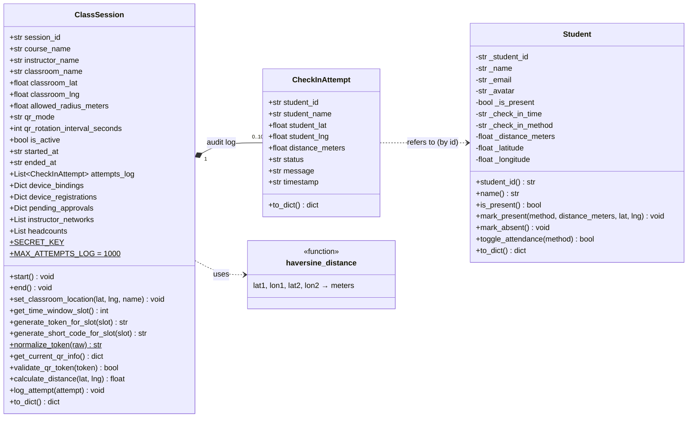
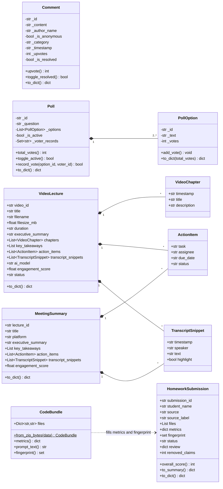
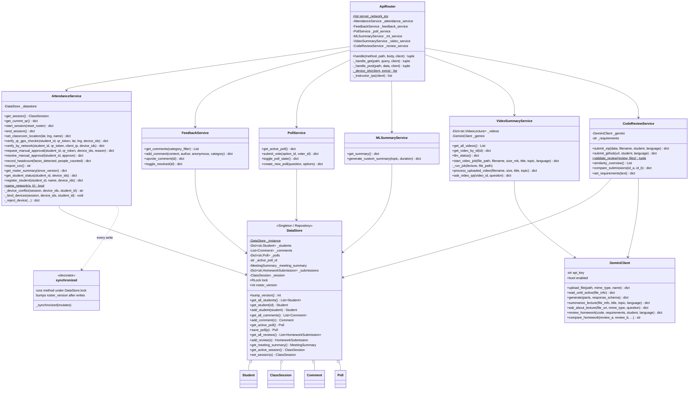
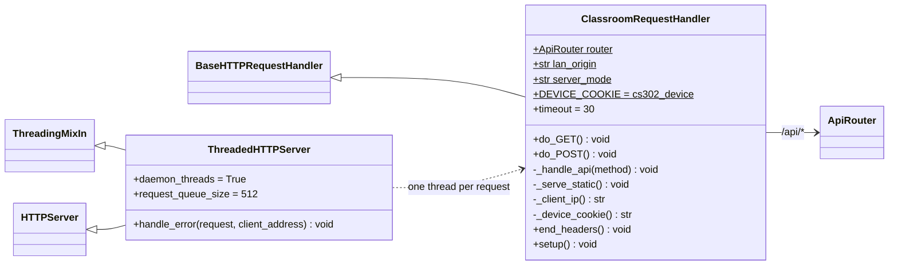
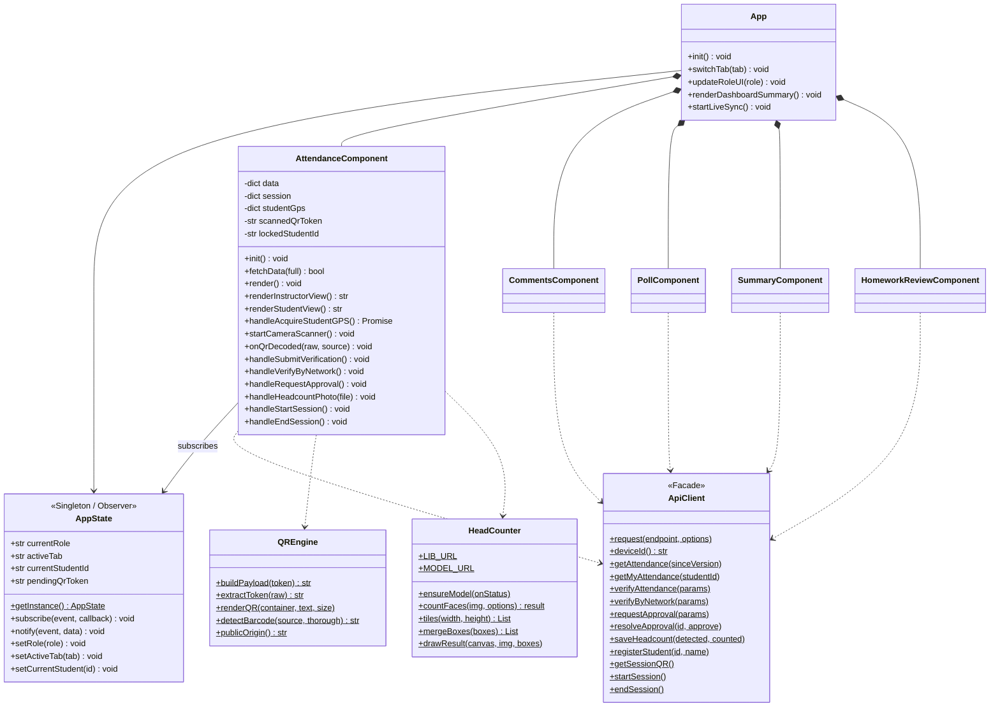

# 6. Low-Level Class Diagrams

The diagrams below are drawn from the actual code (`app/` and `static/js/`). Private fields are marked `-`, public members `+`, static members are underlined (`$`). GitHub renders the Mermaid blocks as images.

- [6.1 Domain model – attendance](#61-domain-model--attendance)
- [6.2 Domain model – comments, polls, video summary, homework review](#62-domain-model--comments-polls-video-summary-homework-review)
- [6.3 Service, repository and API layer](#63-service-repository-and-api-layer)
- [6.4 HTTP server](#64-http-server)
- [6.5 Front-end (browser) classes](#65-front-end-browser-classes)
- [6.6 Design patterns used](#66-design-patterns-used)

---

## 6.1 Domain model – attendance

**Notes**
- `Student` encapsulates its attendance state: it can only change through `mark_present()`, `mark_absent()` and `toggle_attendance()` (tested in `TestStudentModel`).
- `ClassSession` owns everything that is valid for **one lecture**: the HMAC secret for the rotating QR, the geofence (centre = Ariel University, radius 500 m), the audit log and the anti-fraud state (`device_bindings`: phone → student). `start()` clears that state for the next lecture.
- `status` of a `CheckInAttempt` is one of `success`, `rejected_distance`, `rejected_qr`, `rejected_device`, `rejected_network`, `rejected_by_instructor`.

---

## 6.2 Domain model – comments, polls, video summary, homework review

---

## 6.3 Service, repository and API layer

**Notes**
- **Layering:** `ApiRouter` (transport) → `*Service` (business rules) → `DataStore` (data). Models never call services, services never deal with HTTP.
- **Concurrency:** every attendance write goes through `@_synchronized`, which takes `DataStore.lock` and increments `roster_version`. That is how 150–300 simultaneous check-ins stay consistent (see the load test).
- Replacing the in-memory `DataStore` with a database would only change this one class – the services depend on its methods, not on how it stores data.

---

## 6.4 HTTP server

`server.py` also contains the start-up functions `run()`, `start_tunnel()` (Cloudflare quick tunnel), `ensure_self_signed_cert()` (`--https`), `get_lan_ip()` and `detect_public_ips()`.

---

## 6.5 Front-end (browser) classes

---

## 6.6 Design patterns used

| Pattern | Where | Why |
|---|---|---|
| **Singleton** | `DataStore`, `AppState` | One shared roster / one shared UI state |
| **Repository** | `DataStore` | Services don't know how data is stored → easy to swap for a database |
| **Service layer** | `*Service` classes | Business rules separated from HTTP and from data |
| **Facade** | `ApiClient`, `ApiRouter` | One entry point for every API call |
| **Observer** | `AppState.subscribe/notify` | Components re-render when role / tab / student changes |
| **Decorator** | `@_synchronized` | Thread-safety + version bump added to methods without changing their logic |
| **Encapsulation** | `Student`, `Comment`, `Poll` (private `_fields` + properties) | State can only change through validated methods |
