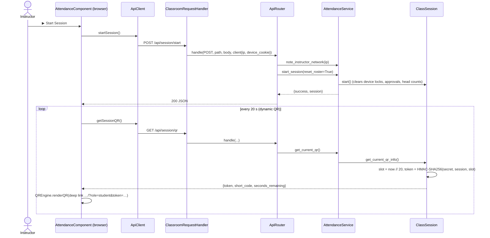
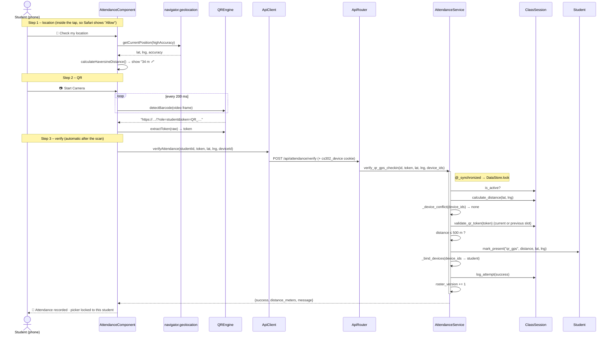
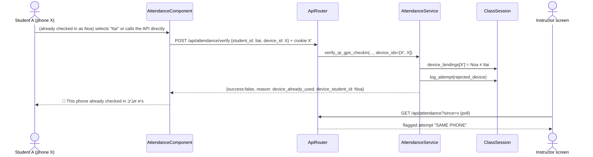
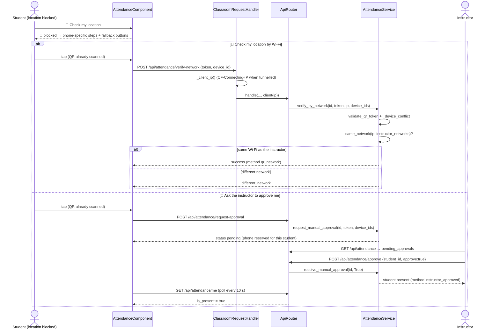
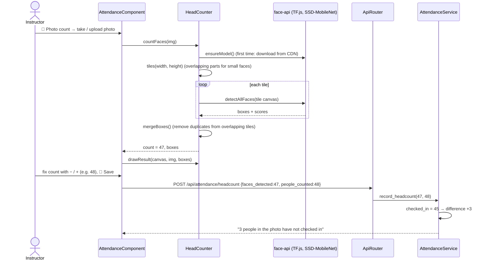
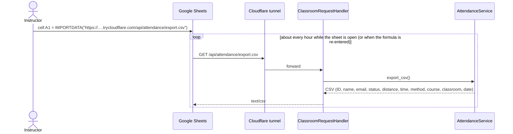
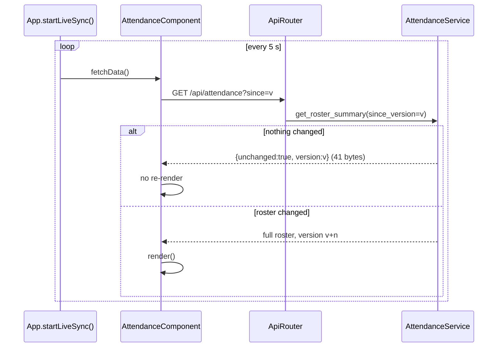
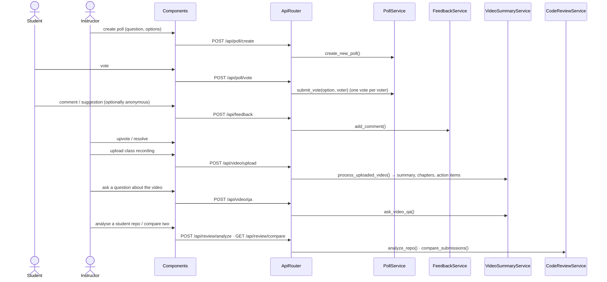
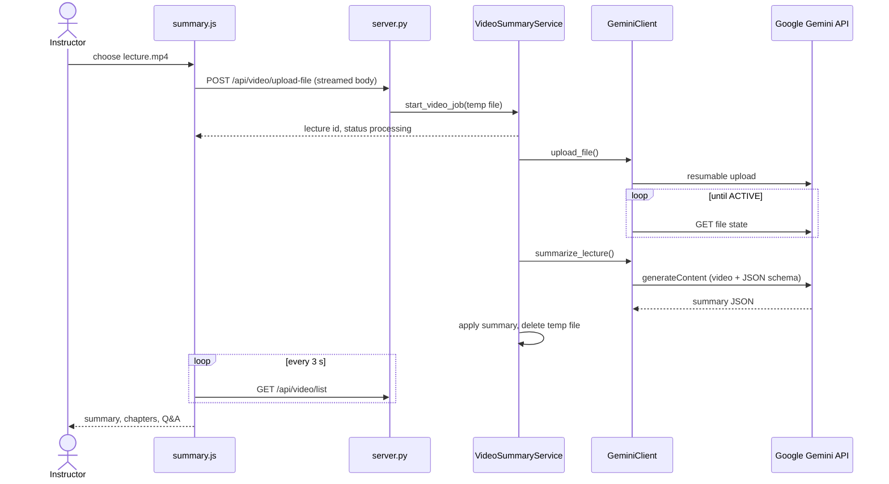

# 7. Sequence Diagrams

Each diagram follows the real calls in the code (class and method names match `app/` and `static/js/`).

- [7.1 Instructor starts a session and projects the rotating QR](#71-instructor-starts-a-session-and-projects-the-rotating-qr)
- [7.2 Student checks in: location → QR → verify (main flow)](#72-student-checks-in-location--qr--verify-main-flow)
- [7.3 Same phone tries to check in a second student (rejected)](#73-same-phone-tries-to-check-in-a-second-student-rejected)
- [7.4 Phone blocks location: Wi-Fi check, then instructor approval](#74-phone-blocks-location-wi-fi-check-then-instructor-approval)
- [7.5 Instructor counts the class from a photo](#75-instructor-counts-the-class-from-a-photo)
- [7.6 Live spreadsheet (Google Sheets IMPORTDATA)](#76-live-spreadsheet-google-sheets-importdata)
- [7.7 Instructor live roster polling (versioned)](#77-instructor-live-roster-polling-versioned)
- [7.8 Poll, comment, video summary, homework review](#78-poll-comment-video-summary-homework-review)

---

## 7.1 Instructor starts a session and projects the rotating QR

---

## 7.2 Student checks in: location → QR → verify (main flow)

Location and QR are **separate steps**: the camera is never open while the phone asks for location.

**Alternative outcomes** (same sequence, different branch): session ended → `session_closed`; expired/wrong token → `invalid_qr` (logged `rejected_qr`); distance > 500 m → `distance_exceeded` (logged `rejected_distance`, shown in 🚨 Flagged Breaches); already present → idempotent success *"already checked in"*.

---

## 7.3 Same phone tries to check in a second student (rejected)

---

## 7.4 Phone blocks location: Wi-Fi check, then instructor approval

---

## 7.5 Instructor counts the class from a photo

The photo is analysed **in the instructor's browser**; only the numbers are sent to the server. Nobody is marked present by the photo.

---

## 7.6 Live spreadsheet (Google Sheets IMPORTDATA)

The **📥 Export CSV** button produces the same table as a file (offline spreadsheet).

---

## 7.7 Instructor live roster polling (versioned)

Student phones do **not** poll the roster: they call `GET /api/attendance/me` every 10 s (own status only).

---

## 7.8 Poll, comment, video summary, homework review

> The video summary calls the real Google Gemini API (sequence below). The homework review still returns simulated model output; see the SRS (§3.4).

### Video upload → Gemini summary

